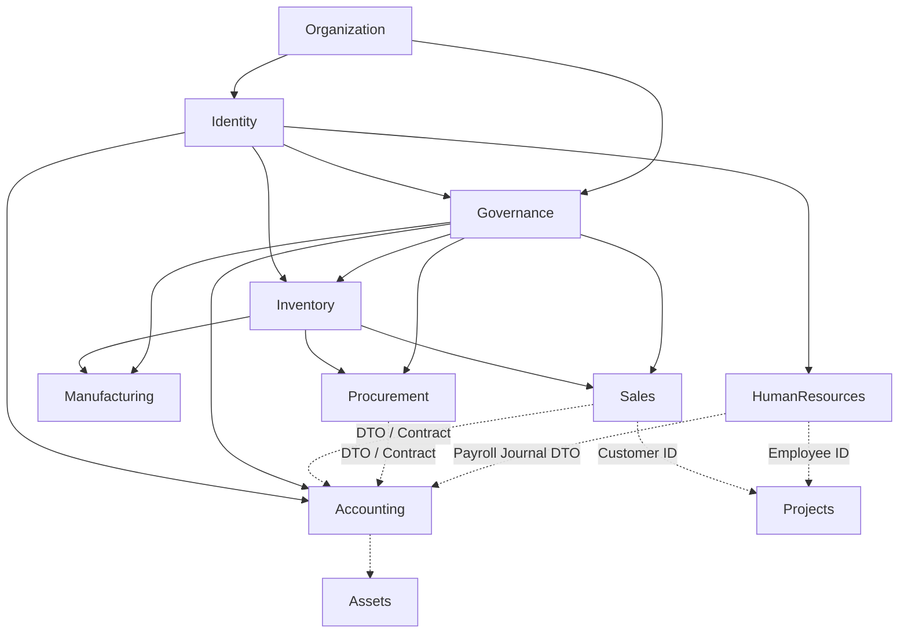

# Module Dependency Graph & DAG Rules

## Directed Acyclic Graph (DAG)

To eliminate circular dependencies and isolate modules, inter-module dependencies strictly flow downward in this directed graph:

## Permitted vs Prohibited Relationships

### Permitted
1. **Public Contracts**: A downstream module (e.g. `Procurement`) may inject a public contract from an upstream module (e.g. `Modules\Inventory\Application\Contracts\StockServiceInterface`).
2. **DTOs**: Data exchanged across boundaries uses immutable data transfer objects (e.g. `Modules\Inventory\Application\DTOs\StockAdjustmentDTO`).
3. **Domain Events**: Modules emit events upon business facts (e.g. `OrderShippedEvent`, `PayrollProcessedEvent`). Other modules register decoupled listeners.
4. **Read Models**: Cross-module analytics query read models or composite controllers without mutating internal states.

### Prohibited
1. **No Reciprocal References**: Module A must never call Module B if Module B already depends on Module A.
2. **No Direct Model Mutation**: `Manufacturing` cannot perform `StockLevel::where(...)->update(...)`. It must invoke `StockServiceInterface::issueMaterial(...)`.
3. **No Direct Internal Imports**: Modules cannot import concrete classes from another module's `Infrastructure\` or `Persistence\` namespaces.
4. **No Service Locator Leaks**: Do not bypass dependency injection using arbitrary `app()` calls or undocumented static singletons.
